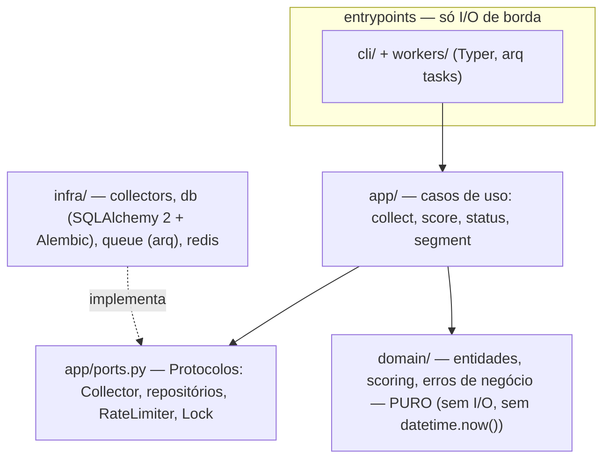

# Estado atual e próximas fases

> Fonte do estado detalhado: [HANDOFF](../HANDOFF.md) — atualizado a cada
> sessão. Esta página traduz o estado em visão de arquitetura; **não é o
> HANDOFF**.

## Arquitetura em camadas (spec §4)

## O que está de pé hoje

| Área | Estado |
|---|---|
| Toolchain | `uv`, ruff (check+format), `pyright` strict 0, pre-commit, bandit, pip-audit |
| Camadas | `domain` (modelos + scoring), `app` (ports, segment), `cli` (`cf segment load`, `cf ping`) |
| Banco | schema Alembic completo (14 tabelas) + repositórios; `alembic check` é gate |
| Segmento | `segments/candles.yaml` validado por pydantic → persistido |
| Infra | compose único (python/postgres/redis), CI `quality` + `docs` + teste de privacidade |
| Docs | 8 tipos + índice + HANDOFF, site `mkdocs build --strict` |

## O que falta (fase B desta entrega)

Tasks 10–18 do [plano](../ai-plans/2026-10-07-fundacao-coletores-banco.md):
fronteira de coleta (registry + FakeCollector) → use-case `collect`
(rate-limit/lock Redis) → coletores YouTube/TikTok/Instagram/Web →
`score` → worker arq com cron 2×/dia → E2E `00`/`01`. Requisitos técnicos
já fechados nos TRDs: [coletores](../specs/trd-collectors.md),
[scoring](../specs/trd-scoring.md), [CLI](../specs/trd-cli.md).

## Próximas frentes (após fundação + coletores)

Ordem aprovada no [PRD](../produto/prd.md) e no spec
[§14](../specs/2026-10-07-content-factory-design.md):

1. **Análise IA → padrões** — vídeo → pattern (estrutura, gatilho);
   biblioteca com embeddings pgvector já prevista no schema.
2. **Ideias e roteiros** — pattern + segmento → ideias → roteiro
   estruturado → production queue.
3. **Feedback loop** — `published_videos` → `performance_metrics` →
   aprendizado → renormalização dos pesos de score.
4. **Transcrição** (Whisper), FastAPI/painel e geração de vídeo entram
   depois, cada um com seu ADR.
