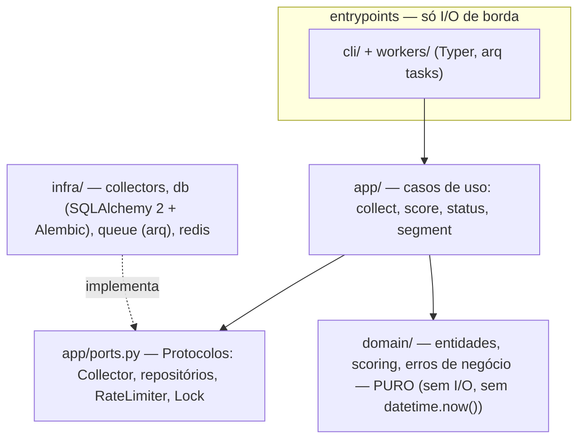

# Estado atual e próximas fases

> Fonte do estado detalhado: [HANDOFF](../HANDOFF.md) — atualizado a cada
> sessão. Esta página traduz o estado em visão de arquitetura; **não é o
> HANDOFF**.

## Arquitetura em camadas (spec §4)

## O que está de pé hoje

| Área | Estado |
|---|---|
| Toolchain | `uv`, ruff (check+format), `pyright` strict 0, pre-commit, bandit, pip-audit |
| Camadas | `domain` puro (modelos + scoring), `app` (ports, collect, score, research), `cli` (`cf collect/score/status/collect-timings/research …`) |
| Banco | schema Alembic completo + repositórios; `alembic check` é gate; `collect_runs` com `skipped`/`discover_ms`/`persist_ms`, `video_scores` com `metrics_available`/`formula_version` |
| Coleta | `collect()` em 2 fases — descoberta concorrente (TaskGroup + semáforo `COLLECT_MAX_CONCURRENCY`) e persistência sequencial; coletores YouTube/TikTok/Instagram/Web |
| Score | `score()` em lote (`upsert_many`, blocos de 500; `ScoreDeps` dataclass) |
| Worker | arq multi-segmento (`active_segments()`, TaskGroup por segmento com `WORKER_MAX_SEGMENTS`, 1 UoW por segmento, `max_jobs=3`); lock com token de posse (Lua CAS); cota/breaker unificados no Redis de `rate_limit_redis_url` |
| Segmento | YAMLs validados por pydantic → persistidos; campanhas via `cf research start/stop/status` |
| Infra | compose (python/postgres/redis + worker), CI `quality` + `docs` + teste de privacidade |
| Docs | manual + índice + HANDOFF, site `mkdocs build --strict` |

## O que falta (pós-concorrência)

A fundação + coletores + worker com cron 2×/dia (Tasks 10–18 do [plano](../ai-plans/2026-10-07-fundacao-coletores-banco.md))
estão de pé, assim como a concorrência do pipeline ([plano](../ai-plans/2026-10-13-content-factory-concorrencia-pipeline.md)).
Requisitos técnicos nos TRDs: [coletores](../specs/trd-collectors.md),
[scoring](../specs/trd-scoring.md), [CLI](../specs/trd-cli.md). Estado fino
e próximos passos: [HANDOFF](../HANDOFF.md).

## Próximas frentes (após fundação + coletores)

Ordem aprovada no [PRD](../produto/prd.md) e no spec
[§14](../specs/2026-10-07-content-factory-design.md):

1. **Análise IA → padrões** — vídeo → pattern (estrutura, gatilho);
   biblioteca com embeddings pgvector já prevista no schema.
2. **Ideias e roteiros** — pattern + segmento → ideias → roteiro
   estruturado → production queue.
3. **Feedback loop** — `published_videos` → `performance_metrics` →
   aprendizado → renormalização dos pesos de score.
4. **Transcrição** (Whisper), FastAPI/painel e geração de vídeo entram
   depois, cada um com seu ADR.
