# Diagrama ER — content-factory

!!! warning "Documento gerado — não edite à mão"
    Fonte: `Base.metadata` (modelos ORM) com gate `alembic check`.
    Regenere: `uv run python scripts/gen_diagram.py` · leitura: 2026-10-08.

- [PNG (2x)](er.png) · [HTML interativo](er.html) ·
  [Fonte mermaid (.mmd)](er.mmd)
- Colunas, tipos e notas: [data model](../data-model/README.md)
