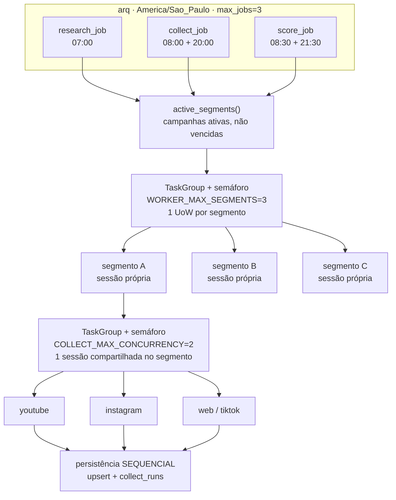
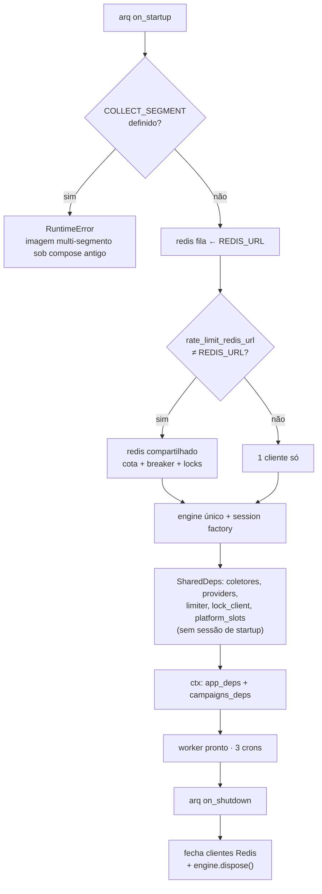
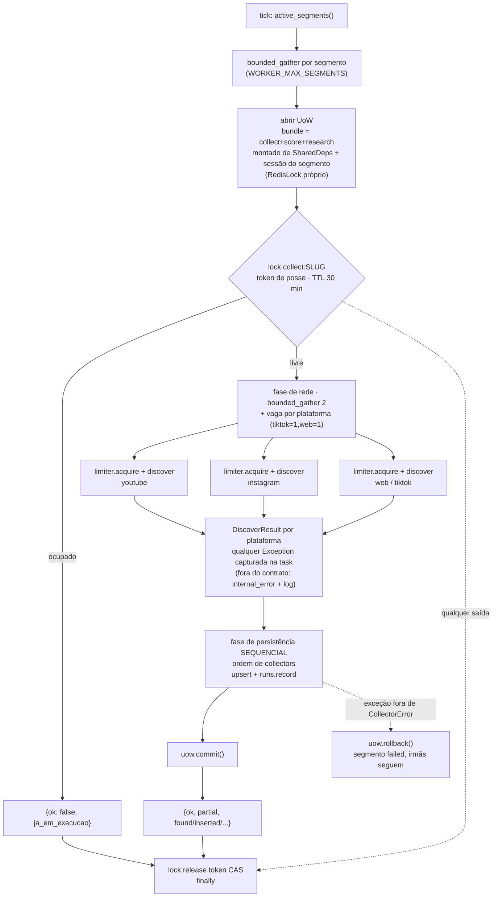
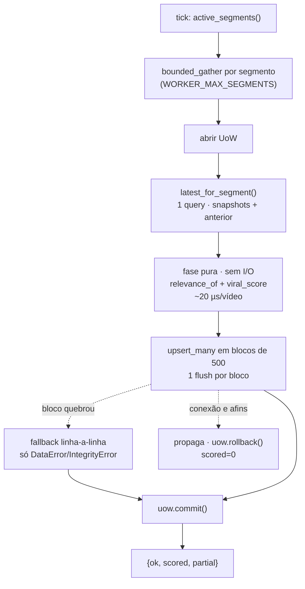
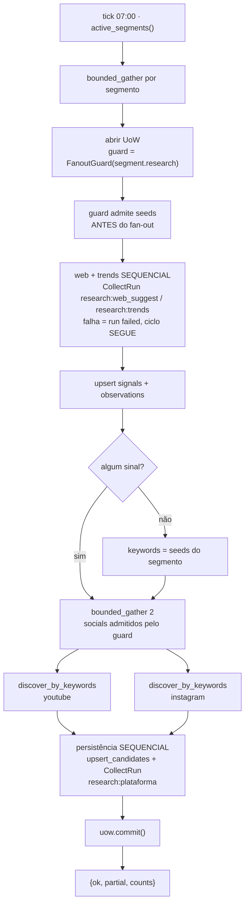
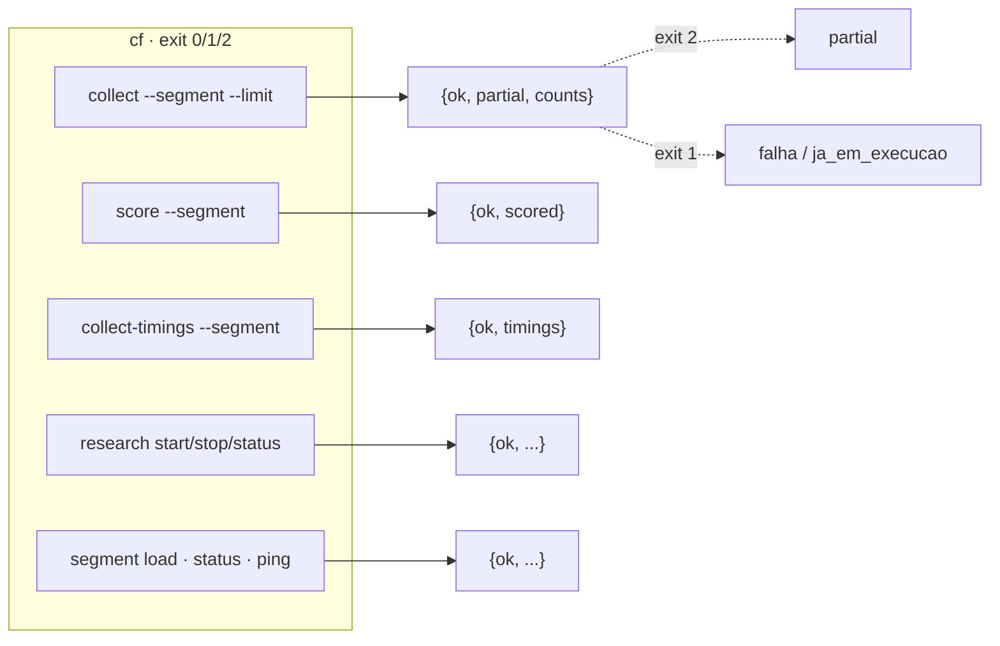
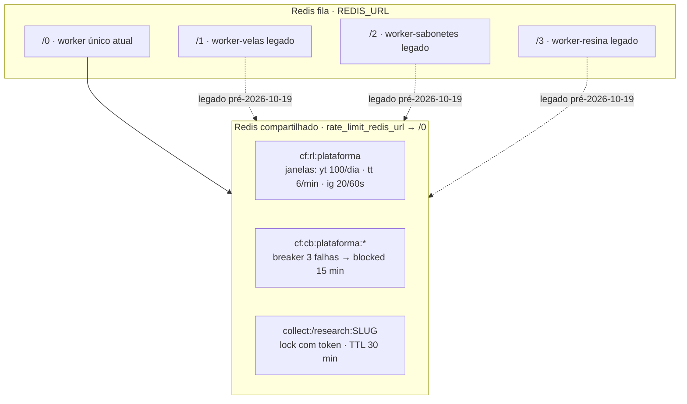

# Fluxos da pipeline — content-factory

> Visão consolidada (mapa mental, relógio do worker, coletores, dados
> salvos, limites e reciclos): [Mapa do ciclo](mapa-do-ciclo.md).

Diagramas do **comportamento em runtime** após a concorrência do pipeline
(plano `../ai-plans/2026-10-13-content-factory-concorrencia-pipeline.md`).
O estado do banco está no [diagrama ER](README.md); o passo a passo do
`cf collect` está no [manual](../manual/fluxo-busca.md).

Convenção: blocos `|||` marcam fronteira de sessão Postgres (1 UoW por
segmento); setas `-.->` são leituras de config/env.

## 1. Visão geral — cron, jobs, segmentos, plataformas

Cada segmento commita ou reverte sozinho: a falha de um nunca reverte os
outros. Exceção não esperada é capturada **dentro** da task do segmento —
`segments` no envelope tem todos os slugs, sem abandono silencioso.

## 2. Startup e shutdown do worker

`on_job_end` não existe mais: cada UoW reverte sozinha em exceção
(`session_scope`). Engine e clientes Redis são compartilhados
(task-safe); **sessão nunca é**.

## 3. `collect_job` — um segmento

`CollectorError` (inclui `RateLimited` e `blocked` do breaker) vira
`collect_runs` `failed`/`blocked` + `failed = 1`, sem bater na API quando
bloqueado. `discover_ms` por plataforma na rede, `persist_ms` no bloco
sequencial.

## 4. `score_job` — um segmento

`video_scores` é append-only: o lote é direto. Linha ruim isola no
savepoint; `partial = erros mas com persistidos`.

## 5. `research_job` — um segmento

O guard é consultado **antes** de agendar cada task (ele muta estado
interno e não é task-safe). Erro de 1 rede social não aborta as demais, e
erro do Suggest/Trends (incluindo `circuit_open`) também não: vira run
`failed` e `web_failed`/`trends_failed`/`source_errors` no envelope.

## 6. CLI — envelope na saída, dados no banco

A CLI monta os deps de cada comando (não usa `AppDeps` do worker) e nunca
imprime linhas do banco — só o envelope.

## 7. Redis — fila, cota e locks

Com um banco Redis por worker legado, cada um tinha sua própria janela e
breaker — a cota real podia ser consumida em até 3x. O worker único + o
Redis compartilhado eliminam o problema por construção; o segundo cliente
permanece para futuros workers por plataforma.
