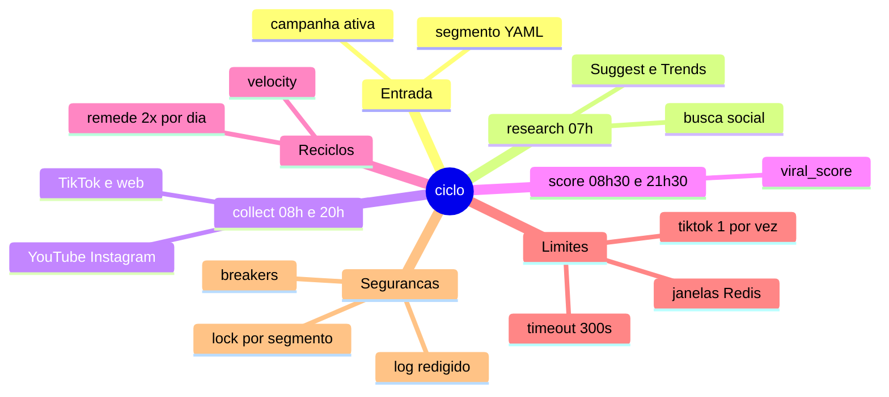
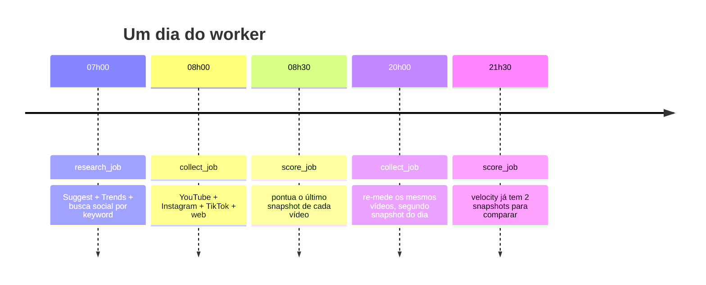
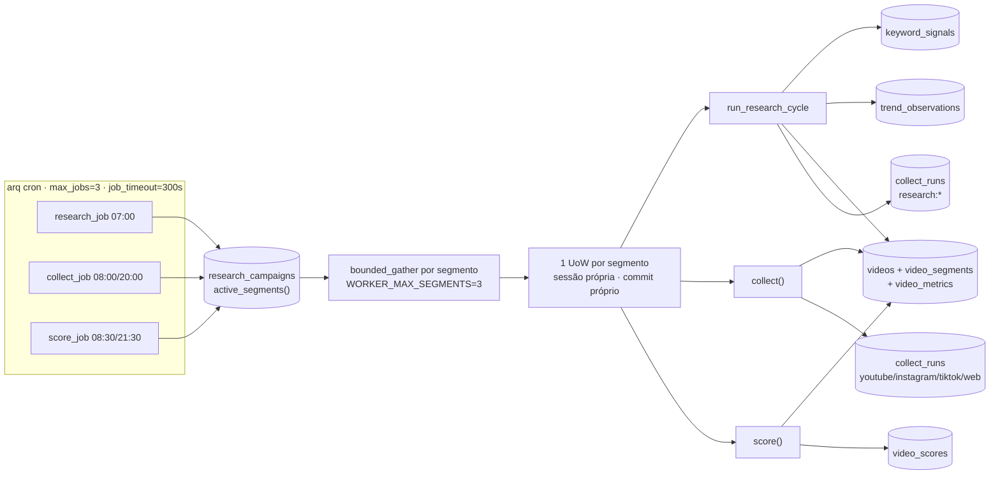
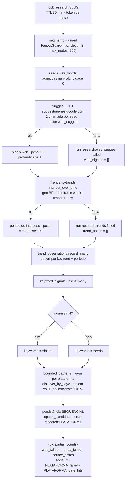
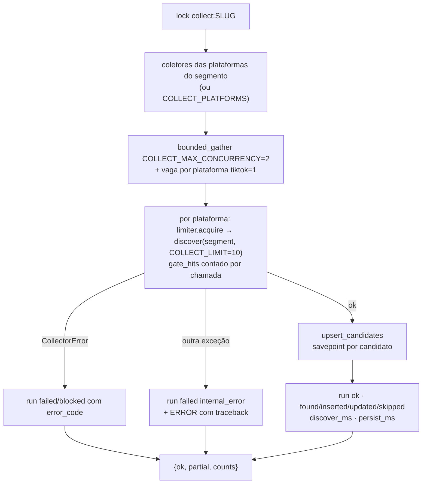
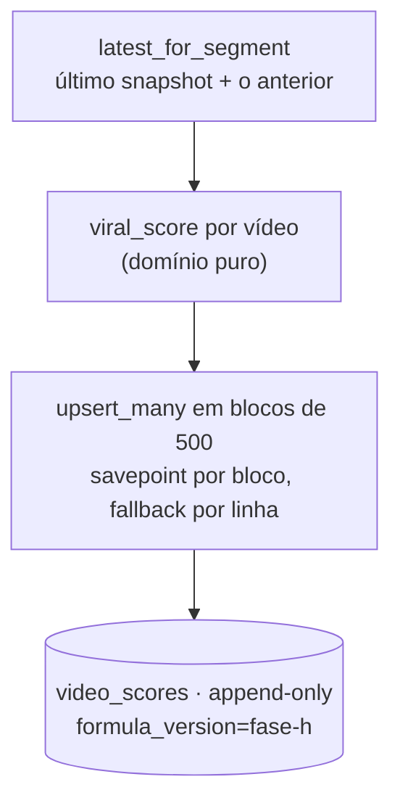
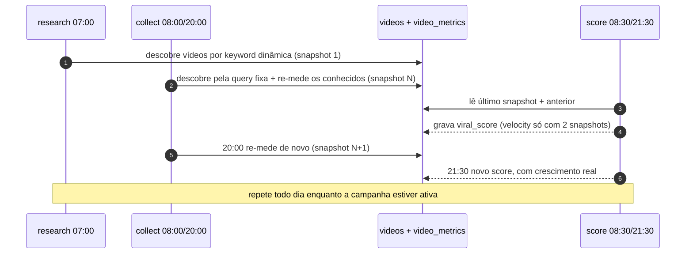

# Mapa do ciclo — pipeline completo

Visão única do content-factory: **o que** cada job busca, **onde** busca,
**o que** salva, **quando** roda, **quanto** pode chamar e **o que acontece**
quando algo falha. Os detalhes de cada diagrama de execução estão em
[Fluxos da pipeline](fluxos.md); a operação está no
[manual de operação](../manual/operacao.md).

!!! note "Escopo"
    Esta página descreve o código da `main` com o worker multi-segmento
    (concorrente) e a Etapa 1 do review (PR #10). Até 2026-10-19, os 3
    workers do experimento de 7 dias rodam a **imagem antiga**: 1 worker
    por segmento, sequencial, e o research aborta quando o Trends falha.

**Objetivo do ciclo:** descobrir, todo dia e para cada segmento (nicho)
com campanha ativa, os vídeos curtos que estão performando. Para isso,
**expande** as palavras-chave do nicho (Suggest/Trends), **busca** vídeos
nas redes (YouTube, Instagram, TikTok, web), **re-mede** os mesmos vídeos
duas vezes por dia para ter crescimento real e **pontua** cada vídeo
(`viral_score`). O resultado é um ranking por segmento em `video_scores`,
que alimenta a fase de IA (ideias/roteiros, ainda não implementada).

## 1. Mapa mental

Cada ramo é detalhado nas seções abaixo: jobs (§3), coletores (§4),
dados salvos (§5), reciclos (§6) e limites/seguranças (§7).

## 2. Relógio do worker (BRT, `America/Sao_Paulo`)

| Job | Cron (BRT) | Configurável | `unique` | Repete por |
| --- | --- | --- | --- | --- |
| `research_job` | 07:00 | não (fixo no código) | sim | campanha ativa (`--weeks N`) |
| `collect_job` | 08:00 e 20:00 | `COLLECT_CRON_HOURS` (default `08,20`) | sim | campanha ativa |
| `score_job` | 08:30 e 21:30 | não (fixo no código) | sim | campanha ativa |

Os três só processam segmentos com **campanha ativa e não vencida**
(`research_campaigns`). Sem campanha, o tick roda vazio (`segments: {}`).
O score roda 30 min depois de cada coleta, de propósito: pontua o snapshot
que acabou de entrar.

## 3. Visão geral: jobs, subtasks e tabelas

Cada segmento roda isolado. Se um levanta, só a UoW dele reverte: o
envelope sai `{ok: false, error, error_type}`, o log registra
`ERROR … segmento X falhou em <job>` com traceback e os outros segmentos
commitam normalmente.

### 3.1 `research_job` — expandir o nicho e buscar por keyword

**Objetivo:** descobrir **sobre o que** o nicho está falando agora
(keywords relacionadas e interesse) e usar isso para achar vídeos que a
busca fixa do collect não acharia.

| Subtask | Chamada | Salva |
| --- | --- | --- |
| Expandir seeds | Suggest, 1 GET por seed (`client=firefox`) | `keyword_signals` (source `web_suggest`) + run `research:web_suggest` |
| Medir interesse | Trends `build_payload` + `interest_over_time` | `trend_observations` (série temporal) + `keyword_signals` (source `trends`) + run `research:trends` |
| Busca social | `discover_by_keywords` por rede com termos dinâmicos | `videos`, `video_segments` (`discovery_source` = plataforma), `video_metrics` + run `research:PLATAFORMA` |

### 3.2 `collect_job` — descoberta fixa por nicho e re-medição

**Objetivo:** buscar os vídeos do nicho em cada rede com a query fixa do
segmento e **re-medir** os já conhecidos. O `ON CONFLICT` atualiza o
vídeo, e cada coleta grava um novo snapshot de métricas.

### 3.3 `score_job` — ranking

**Objetivo:** transformar métricas em um número comparável por segmento.

| Componente | Peso | Cálculo | Ausente quando |
| --- | --- | --- | --- |
| performance | 0,25 | views / 1M × 100 (teto 100) | rede não expõe views (Instagram) |
| velocity | 0,20 | Δviews/Δhoras entre 2 snapshots ÷ 1000 × 100 | só 1 snapshot (vídeo novo) |
| engagement | 0,15 | (likes + 2·comments + 3·shares + 4·saves) / views | sem views |
| relevance | 0,20 | fração das keywords do segmento no título/descrição | nunca (0 se não casa) |
| recency | 0,20 | ≤7 dias 100 · ≤30 dias 50 · >30 dias 15 · sem data 50 | nunca |

Métrica **ausente** sai da média e os pesos são renormalizados; métrica
**zero** conta como zero. `metrics_available` registra o que entrou.

## 4. Coletores: o que cada um chama

| Fonte | Usada em | Chamada | Entrada | Objetivo | Métricas | Limite/custo |
| --- | --- | --- | --- | --- | --- | --- |
| **YouTube** Data API v3 | collect + research | `search` (vídeos dos últimos 7 dias, `order=viewCount`, ≤50) → `videos` (statistics, snippet, contentDetails) → `channels` (inscritos) | collect: `kw1 OR … kw5`; research: até 5 termos, 25 resultados | vídeos em alta do nicho | views, likes, comments, inscritos | search = 100 unidades, list = 1; janela 100 descobertas/dia ≈ cota 10k |
| **Instagram** Graph API v21 | collect + research | collect: `ig_hashtag_search` → `{tag}/top_media` (≤25); fallback: mídia própria (até 3 páginas de 50) | collect: 1ª keyword sem `#`; research: termos filtram a mídia própria | reels do nicho | likes, comments (views não existe para terceiros) | 20/min; **gate #10**: sem App Review cai na mídia própria e conta `gate_hits` |
| **TikTok** TikTokApi + Playwright | collect + research | collect: `trending` (≤60) + `hashtag(kw1)` (≤30); research: `search.videos` (30) | 1ª keyword / 5 termos | vídeos virais | views, likes, comments, shares | 6/min; 1 sessão por vez no processo; **exige `TIKTOK_MS_TOKEN`** (vazio = `auth_expired`) |
| **Web** DuckDuckGo (`ddgs`) | collect | `DDGS().text(query, max_results)` | `kw1 OR kw2 OR kw3` | páginas/artigos do nicho (sem métrica) | nenhuma | janela fallback 10/min; "No results found" = lista vazia |
| **Suggest** Google | research | `GET suggestqueries…/search?client=firefox&q=SEED` | cada seed | keywords relacionadas | — | breaker 5 falhas → 72 h |
| **Trends** Google (`pytrends`) | research | `build_payload(geo=BR)` + `interest_over_time` | keywords do Suggest | interesse relativo (0–100) por semana | — | breaker 5 falhas → 72 h; **HTTP 400 diário em produção** |

Todos os coletores de vídeo devolvem o mesmo `CandidateVideo` (plataforma,
id, url, criador, título, descrição, data, duração, thumbnail, métricas e
payload bruto).

## 5. O que fica salvo

| Tabela | Escrita por | Conteúdo | Granularidade |
| --- | --- | --- | --- |
| `segments` | `cf segment load` | slug, nome, config (keywords, plataformas, profundidade) | upsert por slug |
| `research_campaigns` | `cf research start/stop` | janela da campanha (`ends_at`, `active`) | 1 linha por `start`; `active_segments()` deduplica |
| `videos` | collect + research | metadados do vídeo + `raw` | upsert por (plataforma, id); texto vazio não apaga o conhecido |
| `video_segments` | collect + research | vínculo vídeo↔segmento + `discovery_source` | upsert |
| `video_metrics` | collect + research | views/likes/comments/shares/saves/seguidores | **append** a cada coleta (série) |
| `video_scores` | score | viral_score + componentes + `metrics_available` | **append** a cada score |
| `keyword_signals` | research | keyword, fonte, peso, profundidade | upsert por (segmento, keyword, fonte) |
| `trend_observations` | research | interesse por keyword e período | upsert por período lógico |
| `collect_runs` | collect + research | status, `error_code`, contagens, `discover_ms`/`persist_ms` | 1 linha por plataforma/fonte por execução |

## 6. Ciclos, re-tentativas e recursão

| Mecanismo | Onde | Comportamento |
| --- | --- | --- |
| **Re-medição** | collect 2×/dia | o mesmo vídeo ganha um snapshot por coleta; é o que dá `velocity` |
| **Recursão do research** | `FanoutGuard` | seeds na profundidade 0 → Suggest/Trends na 1; `max_depth=2`, `max_nodes_per_cycle=200`, dedupe por keyword; `fanout_per_stage` corta por peso |
| **Espera do limiter** | `RedisRateLimiter.acquire` | janela cheia: espera com backoff exponencial (1, 2, 4… s, ±20%) até 5 tentativas; espera > 60 s vira `RateLimited` imediato (cota diária não segura o worker) |
| **Backoff do TikTok** | `_call_with_backoff` | resposta vazia: até 5 tentativas com `2^n + 0–2 s`, depois `blocked` |
| **Breaker Suggest/Trends** | `CooldownBreaker` (em memória) | 5 falhas seguidas → `circuit_open` por 72 h (3 ciclos diários); chamadas durante o cooldown não o consomem |
| **Breaker por plataforma no Redis** | `RedisRateLimiter` | existe (3 falhas → 15 min), mas **nenhum caminho chama `record_failure` hoje** — ver Lacunas |
| **Retry do arq** | `max_tries=5` | só vale para `Retry` explícito (nenhum job levanta) ou job cancelado, por exemplo no shutdown do worker; falha de segmento não re-executa o job |
| **Próximo tick** | cron | erro de hoje é retentado naturalmente no próximo horário |

## 7. Limites e seguranças

| Tipo | Item | Valor/regra |
| --- | --- | --- |
| Limite | segmentos simultâneos por job | `WORKER_MAX_SEGMENTS=3` (lido a cada tick) |
| Limite | discovers simultâneos por segmento | `COLLECT_MAX_CONCURRENCY=2` (collect; o research usa 2 fixo) |
| Limite | por plataforma no processo | `PLATFORM_MAX_CONCURRENCY`, sempre com `tiktok=1` |
| Limite | jobs simultâneos | `max_jobs=3` (1 por tipo) |
| Limite | duração do job | `job_timeout=300 s` (default do arq) para **todos** os segmentos do job |
| Limite | janelas no Redis (globais, somam segmentos) | YouTube 100/dia · TikTok 6/min · Instagram 20/min · demais 10/min |
| Segurança | lock por segmento | `collect:SLUG`/`research:SLUG`, TTL 30 min, token de posse com release por Lua (CAS) e 1 instância por UoW |
| Segurança | isolamento | 1 sessão por segmento; erro reverte só a própria UoW |
| Segurança | dados ruins | savepoint por candidato (vídeo) e por bloco (score); `DataError`/`IntegrityError` viram `skipped` |
| Segurança | erro de infra | propaga **original** (sem `PendingRollbackError` mascarando), com traceback no log |
| Segurança | fonte instável | erro de coletor/fonte vira run `failed`; as irmãs seguem |
| Segurança | segredos | tokens via `/run/secrets`; log e envelope passam por `redact()` (`RedactingFilter`); teste de privacidade no CI |
| Segurança | anti-ban | fingerprint real do Playwright, sem forjar; proxy opcional no TikTok; ver [anti-ban](../manual/anti-ban.md) |

## 8. Lacunas conhecidas

- **Breaker por plataforma no Redis inativo.** `RedisRateLimiter.record_failure`
  e `record_success` não são chamados por `collect`/`research`, então a chave
  de bloqueio nunca é gravada.
- **`job_timeout=300 s` com TikTok ativo.** Hoje as coletas levam segundos
  (o TikTok falha na hora, sem token). Com token e `tiktok=1` serializando
  sessões Playwright entre 3 segmentos, o job inteiro pode passar de 5 min e
  ser cancelado.
- **Trends HTTP 400 diário.** Com o PR #10, o research segue sem o Trends;
  falta investigar a causa (`pytrends`/endpoint).
- **Instagram sem App Review (gate #10).** Hashtag de terceiros bloqueada;
  a coleta usa a mídia própria filtrada por keyword e conta `gate_hits`.
- **TikTok sem `TIKTOK_MS_TOKEN`.** Vazio por design no experimento: toda run
  do TikTok é `failed` (`auth_expired`).
