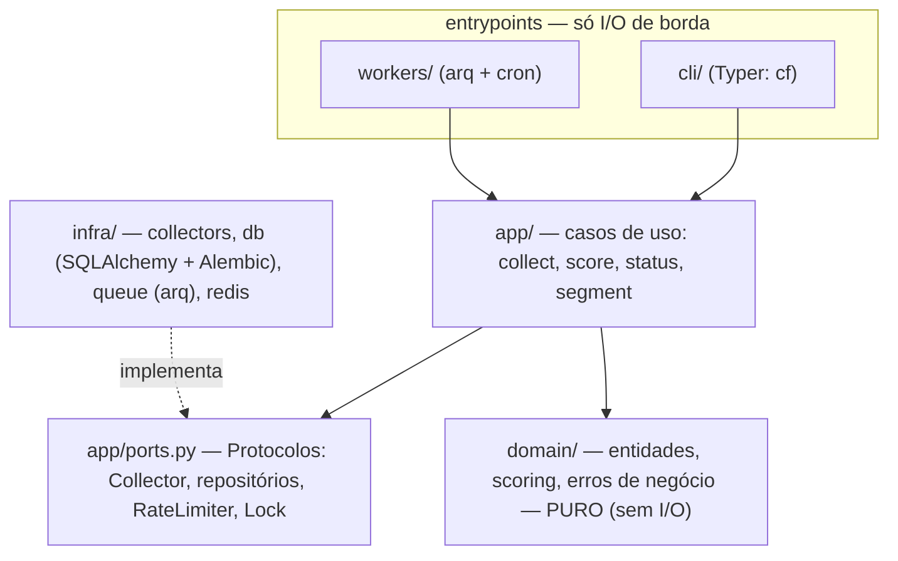

# content-factory

Motor de inteligência de conteúdo parametrizado por segmento: dado um
segmento (`candles` hoje, `macrame` amanhã), o sistema coleta conteúdo
candidato nas plataformas, pontua oportunidades (viral score + trend decay)
e mantém o banco completo pronto para as próximas frentes (abstração de
padrões, ideias, roteiros, produção, feedback loop). O agente **não copia
vídeos** — identifica *por que* um vídeo funciona e deriva ideias originais
do mecanismo.

!!! info "Documentos que governam"
    Design completo: [spec de design](specs/2026-10-07-content-factory-design.md) ·
    O QUE / não-objetivos: [PRD](produto/prd.md) ·
    Estado vivo: [HANDOFF](HANDOFF.md) ·
    Roteamento de todos os docs: [roteamento](roteamento.md)

## Camadas

Regra: dependência **unidirecional** `cli/workers → app → domain`; `infra`
implementa os Protocolos de `app/ports.py` e é injetado nos entrypoints (DI
manual por construtor/registry — sem framework). Detalhes e estado por fase:
[Arquitetura](architecture/README.md).

## Comece por

| Quero… | Vá para |
|---|---|
| Saber onde está cada documento | [roteamento](roteamento.md) |
| Rodar o ambiente e os gates | [dev/dev-environment](dev/dev-environment.md) |
| Ver o que existe hoje e o que falta | [architecture/estado-e-proximas-fases](architecture/estado-e-proximas-fases.md) |
| Conferir as tabelas / o ER | [data-model](data-model/README.md) · [diagram](diagram/README.md) |
| Estender (segmento YAML / novo collector) | [dev/extending](dev/extending.md) |
