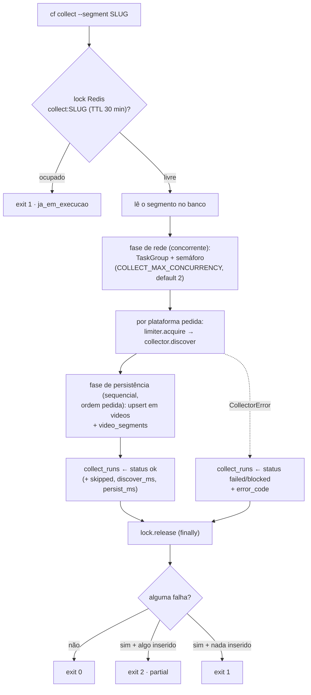

# Fluxo de busca — da plataforma ao banco

Este capítulo explica **o que acontece por dentro** quando você roda
`cf collect`: o lock, o rate-limit, o que cada plataforma faz (e como ela
falha), e como os candidatos viram linhas em `videos`/`video_segments` até
`cf score` gravar `video_scores`. Para *rodar* a primeira busca, use o
[Primeiro passo](guide-start.md); o contrato de envelope/exit codes está em
[TRD CLI](../specs/trd-cli.md).

## 1. O que acontece quando `cf collect` roda

Passo a passo (`app/collect.py`):

1. **Lock por segmento.** `acquire_once("collect:{slug}")` no Redis
   (token de posse por aquisição + TTL de **30 min**; o `release` só apaga
   via script Lua atômico quando o valor ainda é o token do dono — `release`
   de dono obsoleto é no-op, então um lock readquirido nunca é apagado pelo
   dono antigo). Se já estiver ocupado, a coleta não
   começa: a CLI devolve `{"ok": false, "error": {"code": "ja_em_execucao"}}`
   e **exit 1** — nunca force. O TTL cobre o caso de worker morto no meio da
   coleta (lock órfão não sobrevive 30 min); o `finally` libera o lock em
   qualquer saída.
2. **Leitura do segmento.** Slug inexistente → `segment_not_found` (exit 1).
3. **Duas fases** (`--platform` vazio usa as plataformas declaradas no
   segmento):
   - **Fase de rede (concorrente).** `limiter.acquire(platform)` +
     `collector.discover(segment, limit)` rodam sob `TaskGroup` com semáforo
     (`COLLECT_MAX_CONCURRENCY`, default 2) — janela por plataforma no Redis
     (tabela da seção 2); janela estourada espera com backoff, e se a espera
     passaria de 60 s falha na hora com `rate_limited` (fonte de cada
     plataforma, tabela da seção 2);
   - **Fase de persistência (sequencial, determinística).** Na ordem pedida
     (não na ordem de término da rede): `videos.upsert_candidates(...)` —
     upsert idempotente (seção 3) — e uma linha em `collect_runs` por
     plataforma **no sucesso e em qualquer falha de plataforma (caminho
     `CollectorError`)**, gravada no `finally`: `status` `ok`/`failed`/
     `blocked`, `error_code`, `found`, `inserted`, `updated`, `skipped`,
     `discover_ms` (fase de rede), `persist_ms` (fase de persistência),
     `finished_at`.
   - **Fronteira de erro.** `CollectorError` de uma plataforma é capturado
     na própria task e não derruba as irmãs. Exceção **não**-`CollectorError`
     (bug, erro inesperado de lib) **propaga**: cancela as tasks irmãs e
     aborta antes de persistir — sem linha de auditoria para o lote (no
     worker a UoW do segmento reverte sozinha; ver
     [Operação §3](operacao.md#3-logs)).
4. **Desfecho.** `CollectorError` de uma plataforma não derruba as demais.
   Exit codes: `0` = tudo ok · `2` = **parcial** (alguma falhou, algo foi
   inserido ou atualizado) · `1` = erro total (tudo falhou ou lock ocupado).

### Vocabulário de erros (mesmos nomes em todo o manual)

Códigos gravados em `collect_runs.error_code`
([erros do domínio](../specs/trd-collectors.md)):

| Código | Significado típico |
|---|---|
| `auth_expired` | credencial ausente/expirada (token, cookie) |
| `rate_limited` | cota/janela estourada sem espera possível |
| `blocked` | anti-bot (TikTok) ou circuito aberto do limiter |
| `upstream_changed` | a API mudou: HTTP ≥ 400 não mapeado, JSON com shape estranho |
| `network` | falha de rede/timeout na chamada |
| `invalid_payload` | payload rejeitado na validação (reservado) |

## 2. Uma seção por plataforma

Resumo (fonte, credencial, janela do limiter e erros). As janelas são as
`DEFAULT_WINDOWS` do limiter Redis (`infra/ratelimit.py`); a plataforma sem
janela própria usa a fallback:

| Plataforma | Fonte | Credencial (env) | Janela do limiter | Erros típicos |
|---|---|---|---|---|
| `youtube` | YouTube Data API v3 | `YOUTUBE_API_KEY` | 100 / 24 h | `rate_limited` (403), `upstream_changed`, `network` |
| `tiktok` | TikTok-Api + Playwright headless | `TIKTOK_MS_TOKEN` (+ `TIKTOK_PROXY` opcional) | 6 / 60 s | `auth_expired`, `blocked` (anti-bot) |
| `instagram` | Graph API v21.0 | `INSTAGRAM_ACCESS_TOKEN` + `IG_USER_ID` | 20 / 60 s | `auth_expired` (400/401), `upstream_changed` |
| `web` | DuckDuckGo (`ddgs`, sem chave) | nenhuma | fallback 10 / 60 s | — (ver nota) |

Chaves de como criar cada credencial: [Chaves de API](chaves-api.md) ·
rotação em [credentials](../dev/credentials.md).

### YouTube

- **Fonte:** YouTube Data API v3 — `search` (custo **100** unidades) + `videos`
  e `channels` (custo **1** unidade cada) por descoberta. Cota padrão da API:
  **10.000 unidades/dia** ≈ 100 descobertas/dia — **≈** a janela do limiter
  (100/24 h; na prática ~98, 102 U por descoberta). A busca cobre os keywords
  do segmento (até 5, unidos
  com `OR`), ordena por visualizações e restringe aos últimos 7 dias.
- **Credencial:** `YOUTUBE_API_KEY`.
- **Erros:** `403` → `rate_limited` (cota esgotada ou chave/origem bloqueada);
  `HTTP ≥ 400` não mapeado, resposta não-JSON ou shape inesperado (inclusive
  `search` sem `items`) → `upstream_changed`; falha de rede/timeout →
  `network`.
- **Nota:** o custo acumulado é contado no coletor (`quota_used`); a coluna
  existe em `collect_runs`, mas o `cf collect` de hoje grava `0` — confie na
  janela do limiter, não nessa coluna.

### TikTok

- **Fonte:** TikTok-Api por trás do Playwright **headless** (sessão por
  invocação, fingerprint real — sem forjar UA). Busca `trending` + hashtag
  (primeiro keyword do segmento), deduplica por id e corta no `limit`.
- **Credencial:** cookie `ms_token` em `TIKTOK_MS_TOKEN` (conta
  **secundária** — regra da [anti-ban](anti-ban.md)); proxy opcional via
  `TIKTOK_PROXY`.
- **Erros:** sem token → `auth_expired` na hora (sem retry cego); o
  anti-bot (`EmptyResponseException`) é a única falha com retry:
  **`2**attempt + jitter(0..2 s)`, no máx. 5 tentativas**, depois →
  `blocked` (gravado como `collect_runs.status='blocked'`).
- **Limite real:** 6 descobertas/minuto (janela 6/60 s) — a mais restrita do
  projeto.

### Instagram

- **Fonte:** Graph API v21.0 — `ig_hashtag_search` com a 1ª keyword
  normalizada como hashtag (sem `#`, sem espaços: `vela artesanal` →
  `velaartesanal`) e `/{hashtag_id}/recent_media` (últimas 24 h, até 25
  posts: legenda, curtidas, comentários, link, tipo). Só `VIDEO` (Reels e
  vídeo de feed) vira candidato; carrossel e imagem são descartados.
  `top_media` não é usado: na sondagem de 2026-10-15 não trazia nenhum
  Reel. Mídia de hashtag **não tem autor** (`username`) nem miniatura.
- **Limite:** 30 hashtags únicas por conta a cada 7 dias (o `collect` usa 1
  por segmento). O `research` do Instagram continua na mídia própria.
- **Credencial:** `INSTAGRAM_ACCESS_TOKEN` + `IG_USER_ID`.
- **Erros:** `400`/`401` → `auth_expired` (token errado/expirado); `HTTP ≥
  400` demais, não-JSON ou JSON inesperado → `upstream_changed`; rede →
  `network`. O header `X-App-Usage` é **só informativo** (o coletor lê o
  `call_count`, não reage a ele).
- **Segredo:** a Graph API recebe o token na query string; por isso o erro de
  rede do Instagram passa por `redact` antes de virar mensagem, e a CLI
  redige as mensagens de erro de `collect`/`ingest`/`score`/`status` antes de
  imprimir — o token nunca vaza em log ou stdout.

### Web

- **Fonte:** busca textual no DuckDuckGo via `ddgs` (sem chave, sem cadastro;
  roda em thread porque a lib é síncrona). É a plataforma usada no
  [Primeiro passo](guide-start.md).
- **Identidade:** `platform_video_id` é o **SHA-1 da URL**
  (`sha1(url).hexdigest()`, 40 chars ≤ o limite de 64 do banco); a URL cheia
  vive em `url`/`raw` — URLs longas estouravam o `VARCHAR(64)` e derrubavam o
  upsert inteiro (bug de E2E já corrigido).
- **Erros:** sem classificador próprio — falha de rede do `ddgs` sobe como
  erro interno da CLI (exit 1). A janela fallback (10/60 s) existe justamente
  para o caso de a plataforma não declarar janela própria.

## 3. Workflow até o banco

**Gravado pelo `cf collect`:**

| Tabela | O que entra | Idempotência |
|---|---|---|
| `videos` | um vídeo por candidato (`platform` + `platform_video_id`, url, título, descrição, duração, thumbnail, `raw`) | `INSERT … ON CONFLICT (platform, platform_video_id) DO UPDATE` (título + `last_collected_at`; inserto de verdade é contado via `xmax`) |
| `video_segments` | vínculo vídeo↔segmento com `discovery_source` (plataforma) | `ON CONFLICT (video_id, segment_id) DO UPDATE` |
| `collect_runs` | 1 linha por plataforma por execução: `status`, `error_code`, contagens (`found`/`inserted`/`updated`/`failed`/`skipped`), `discover_ms`, `persist_ms` | append de auditoria (sem conflito) |

Schema campo a campo: [Data model](../data-model/README.md).

**Depois: `cf score --segment SLUG`** (detalhes em
[Análise](analise.md) e [TRD scoring](../specs/trd-scoring.md)):

1. Lê `videos` ⋈ `video_segments` do segmento, com **`LEFT JOIN` em
   `video_metrics`** (captura mais recente por vídeo via `DISTINCT ON`);
   vídeo sem métricas capturadas entra com métricas **zeradas**.
2. Calcula `viral_score` (performance, velocity, engagement, relevance,
   recency) e `trend_decay` (`none`/`low`/`medium`/`high` por idade) —
   cálculo **puro de domínio**, sem I/O.
3. Grava em `video_scores` — tabela **timeseries**: 1 linha por cálculo
   (append, sem `ON CONFLICT`), em lote via `upsert_many` (blocos de 500, 1
   `flush` por bloco; bloco quebrado cai para linha-a-linha com savepoint —
   falha de um vídeo não derruba o lote; daí o exit `2` de parcial). Cada
   linha leva `metrics_available` (quais métricas existiam) e
   `formula_version`. O cálculo é CPU trivial (~20 µs/vídeo, `ScoreDeps`
   dataclass) — sem paralelismo de CPU; o ganho está no lote de I/O.

## 4. Verdade documentada (limites honestos)

- **`video_metrics` não é capturada em produção hoje** — apenas testes
  escrevem nela. Como o score usa `LEFT JOIN` com zero-fill, **todos os
  scores atuais são placeholder**: com métricas zeradas, `performance` e
  `engagement` ficam em 0 e o ranking reflete praticamente só recência e a
  relevância textual do título/descrição. Trate o `viral_score` atual como
  ordem de grandeza, não como métrica — a fase de captura de métricas vem
  depois.
- **O circuit breaker do limiter existe, mas ainda não é alimentado pelo
  `cf collect`** (3 falhas consecutivas → 15 min de `blocked` é comportamento
  do limiter em si; o use-case de hoje não chama `record_failure`).
- **`cf ingest` é a rota alternativa** para URL avulsa (sem descoberta):
  `cf ingest --url URL [--segment SLUG]` passa por uma **guarda SSRF**
  obrigatória (fail-closed: sem guarda injetada nada é buscado; só
  `http(s)` público — IPs privados, loopback, link-local e CGNAT são
  bloqueados), baixa o HTML (timeout 10 s, teto de 2 MB), extrai
  título/descrição e grava como candidato `platform="web"` pelo mesmo upsert
  idempotente.

## 5. Próximo passo

- Quer **rodar** isso no dia a dia (worker, cron, logs, rotinas):
  [Operação](operacao.md).
- Quer **limitar risco** de ban nas plataformas: [Anti-ban](anti-ban.md).
- Códigos normativos de CLI/erros: [TRD CLI](../specs/trd-cli.md) ·
  [TRD coletores](../specs/trd-collectors.md).
