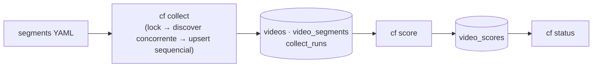

# Manual de operação

Este manual é o ponto de entrada para **operar o content-factory** no dia a dia:
subir o serviço, rodar buscas, pontuar e analisar resultados. É escrito para dois
públicos ao mesmo tempo — o **humano** que opera e o **agente de IA** que executa
via CLI `cf`. Cada capítulo é autossuficiente e linka de volta para este índice; o
contrato da CLI (envelope JSON de uma linha, exit codes) está em
[TRD CLI](../specs/trd-cli.md).

## Roteamento — quero… → capítulo

| Quero… | Ir para |
|---|---|
| Rodar a primeira busca (do zero ao primeiro coletor verde) | [Primeiro passo](guide-start.md) |
| Entender a lógica das buscas por plataforma | [Fluxo de busca](fluxo-busca.md) |
| Subir/verificar o serviço, logs e rotinas | [Operação](operacao.md) |
| Configurar o agente de IA (operador diário) | [Runbook do agente](agentes.md) |
| Analisar resultados (queries SQL prontas) | [Análise](analise.md) |
| Evitar ban / segurança operacional | [Anti-ban](anti-ban.md) |
| Criar chaves das APIs (YouTube, Instagram, TikTok) | [Chaves de API](chaves-api.md) |

## Pipeline

Ciclo típico: segmento YAML carregado → `cf collect` busca candidatos (lock
Redis por segmento, discover concorrente por plataforma sob TaskGroup +
semáforo, persistência sequencial com upsert idempotente) e
audita tudo em `collect_runs` (com `skipped`, `discover_ms`, `persist_ms`) →
`cf score` recalcula viral score + trend decay em lote em `video_scores`
→ `cf status` resume o estado operacional do segmento.

## Tabela verdade dos comandos `cf`

| Comando | O que faz | Exit codes |
|---|---|---|
| `cf ping` | healthcheck sem banco | `0` · `1` |
| `cf segment load PATH` | valida (pydantic) e grava/atualiza o segmento | `0` · `1` |
| `cf collect --segment SLUG [--platform a,b] [--limit N]` | coleta → upsert idempotente; `N` 1–50, default 10 | `0` · `2` · `1` |
| `cf ingest --url URL [--segment SLUG]` | enriquece URL fornecida e grava candidato | `0` · `1` |
| `cf score --segment SLUG` | recalcula viral score + trend decay (lote) | `0` · `2` · `1` |
| `cf status --segment SLUG` | resumo operacional | `0` · `1` |
| `cf collect-timings --segment SLUG` | agregado de `discover_ms`/`persist_ms` por plataforma (7 dias, só leitura) | `0` · `1` |
| `cf ops-report --segment SLUG [--hours 24]` | relatório operacional da janela (só leitura): por coletor e fonte do research, status, taxa ok, **suficiência** (`data_runs`/`data_rate` = runs ok com `found > 0`, `found_avg_ok`), vazios, erros e quota; `web_empty` (sempre ambíguo); runs `blocked`; ticks com duração de parede separada da soma `discover_ms + persist_ms`; cobertura de métricas por plataforma em dois escopos nomeados (`coverage.segment_all_time` e `coverage.window`, só vídeos com snapshot na janela); scores da janela. Ticks a menos de 10 min entre si (ex.: 2 execuções manuais) aparecem juntos | `0` · `1` |
| `cf research start --segment SLUG [--weeks N]` | inicia campanha de pesquisa (default 4 semanas) | `0` · `1` |
| `cf research stop --segment SLUG` | encerra a campanha ativa | `0` · `1` |
| `cf research status --segment SLUG` | mostra campanha ativa + `ends_at` | `0` · `1` |

**Exit codes:** `0`=ok · `2`=parcial (alguma plataforma falhou; o lote seguiu) ·
`1`=erro/uso — contrato normativo em [TRD CLI](../specs/trd-cli.md).

Notas de uso:

- A CLI roda **dentro** do container: `docker exec cf-python uv run cf <cmd>`.
- Saída é **uma linha JSON** (envelope `{"ok": …}` / `{"ok": false, "error": …}`);
  a CLI **não dumpa dados** — resultados ficam no banco e são lidos por lá
  ([ADR-0004](../adr/0004-cli-first.md)).

## Comandos por capítulo

O [Primeiro passo](guide-start.md) monta o caminho `ping → segment load →
collect → score → status` do zero. Detalhes de cada estágio: [Fluxo de
busca](fluxo-busca.md). Rotinas de subida, logs e worker: [Operação](operacao.md).
Rotina diária do agente: [Runbook do agente](agentes.md).
